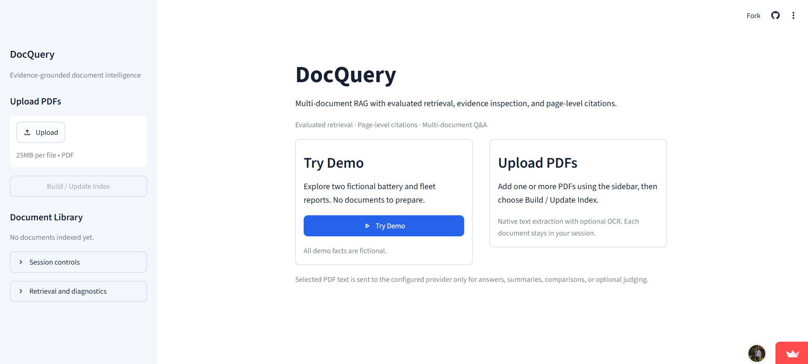
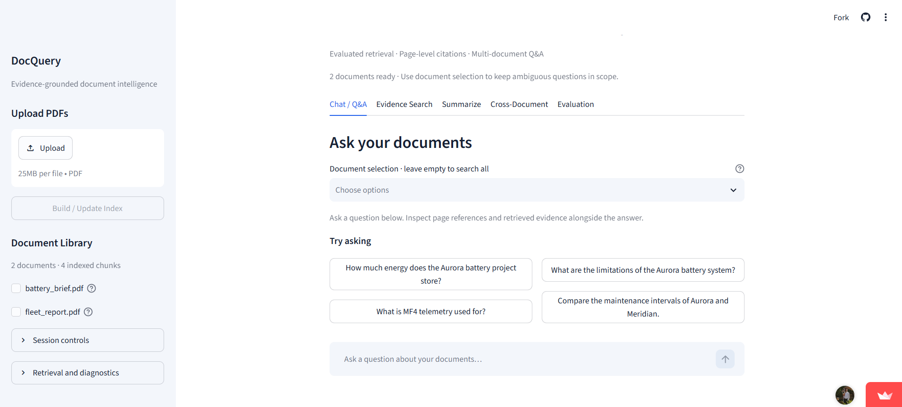
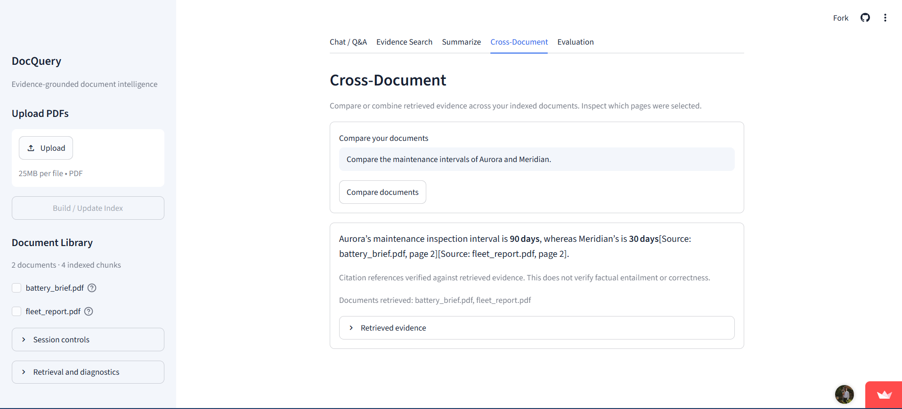

# DocQuery

Multi-document RAG with evaluated retrieval, evidence inspection, and page-level citations.

[Live Demo](https://docquery-rag.streamlit.app) | [GitHub Repository](https://github.com/VViswaPrahlad/DocQuery)

DocQuery lets you ask questions across PDFs while keeping the source passages easy to inspect. The Streamlit app retrieves relevant text, answers through a Groq-hosted LLM, and shows document/page references alongside the evidence. We also compared retrieval strategies with a small offline benchmark.

## Demo

Choose **Try Demo** to load two fictional reports, or upload your own PDFs.



Start with the demo or your own documents.



Click a suggested question to try the demo.



Compare information across documents and inspect the source pages.

## Features

- Multiple PDF uploads with PyMuPDF text extraction and Tesseract/pytesseract OCR fallback.
- Page-aware chunks that retain document names, page numbers, and extraction metadata.
- BGE embeddings, FAISS dense retrieval, BM25 lexical retrieval, and Hybrid Reciprocal Rank Fusion (RRF).
- Document-scoped questions, conversational follow-ups, and cross-document Q&A.
- Retrieved evidence inspection and page-level citations.
- Document summarization across all chunks.

## How It Works

```text
PDFs
 -> text extraction / OCR fallback
 -> page-aware chunks
 -> BGE embeddings
 -> FAISS / BM25 / RRF retrieval
 -> retrieved evidence
 -> Groq-hosted LLM
 -> answer + page citations
```

Embeddings use `BAAI/bge-base-en-v1.5`. Dense search ranks normalized vectors, BM25 matches terms, and RRF combines their rankings. Document scope limits retrieval to selected PDFs; follow-up queries include recent user questions to carry context forward.

Chunks stay within page boundaries so answers can point back to the original PDF. Each visitor has a separate in-memory document store. Uploading changed content under the same filename replaces that document, and summaries process the full document in bounded batches.

## Retrieval Evaluation

We created a small controlled benchmark with 36 questions across 6 fictional documents, including scoped questions, follow-ups, cross-document comparisons, and unanswerable questions.

| Method | Hit@3 | Recall@3 | MRR@3 |
| --- | ---: | ---: | ---: |
| Dense / FAISS | 1.000 | 0.966 | 0.931 |
| BM25 | 0.793 | 0.733 | 0.638 |
| Hybrid RRF | 0.931 | 0.897 | 0.810 |

Dense retrieval performed best on this benchmark. Hybrid RRF was useful to implement and evaluate, but lexical matches sometimes promoted distractors over stronger dense results. This small benchmark is not a claim that dense retrieval is universally better.

See [the evaluation report](docs/evaluation.md) for question-level results and measurement details.

## Setup

Use Python 3.13. From the project directory on Windows:

```powershell
python -m venv venv
.\venv\Scripts\python.exe -m pip install -r requirements-dev.txt
Copy-Item .env.example .env
# Set GROQ_API_KEY in .env before running the app.
.\venv\Scripts\python.exe -m streamlit run app.py
```

On Linux/macOS, use `venv/bin/python` and `cp .env.example .env`. App-only installs can use `requirements.txt`; `requirements-dev.txt` also includes pytest.

Set `GROQ_API_KEY` in `.env`; the default generation model is `openai/gpt-oss-120b`. The embedding model may download on first use. Offline retrieval evaluation requires it to be cached already.

For scanned/image-only PDFs, install the Tesseract system executable and English language data, then make it available on PATH. Installing `pytesseract` alone does not install Tesseract.

## Tests

```powershell
.\venv\Scripts\python.exe -m pytest tests -q
.\venv\Scripts\python.exe -m scripts.evaluate_retrieval --output .runtime/evaluation-recheck.md
```

Tests cover ingestion, document replacement, retrieval, citation references, provider errors, and Streamlit interactions. The retrieval evaluation runs offline without provider calls; the output option preserves the committed report.

## Project Structure

```text
app.py                 Streamlit UI and session state
config.py              Environment and provider settings
ingest.py               PDF parsing, chunks, embeddings, FAISS
ocr_utils.py            OCR fallback
hybrid_search.py        BM25 and RRF
rag_engine.py           Retrieval context and generation
citations.py            Citation-reference validation
evaluation.py           Retrieval metrics and optional judging
tests/                  Regression tests and evaluation fixtures
scripts/                Evaluation runner and privacy audit
docs/                   Evaluation report and demo screenshots
```

## Notes / Limitations

Citation-reference validation checks whether cited document/page references belong to retrieved evidence; it does not prove factual correctness or entailment. Complex PDF layouts and OCR may not extract perfectly.

## Privacy / License

Secrets, uploaded PDFs, and runtime files are gitignored. Generation sends selected document context to the configured provider. Project code and fixtures use the [MIT License](LICENSE).
