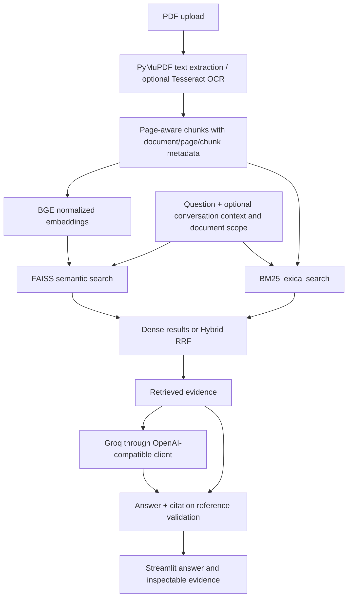

# DocQuery — Multi-document RAG with evaluated retrieval, evidence inspection, and page-level citations.

DocQuery turns uploaded PDFs into searchable evidence and answers questions with document/page citations. Its Streamlit interface supports scoped chat, evidence search, document summaries, cross-document comparisons, and inspection of the text supplied to the model.

**Dense/FAISS performed best on the frozen 36-question evaluation.** BM25 and Hybrid RRF remain available as evaluated comparison strategies. This project demonstrates retrieval trade-offs and practical RAG engineering; it does not claim hybrid superiority.

## Try the demo

Start the app after setup:

```powershell
.\venv\Scripts\python.exe -m streamlit run app.py
```

Choose **Try Demo** to load two fictional reports, or upload your own PDFs and select **Build / Update Index**. Evidence search needs cached embeddings but no LLM key; answers and summaries require provider access.

A short walkthrough:

1. Ask “How much energy does the Aurora battery project store?” The demo fact is 24 megawatt-hours. Expand the retrieved evidence and inspect its page reference.
2. Select the battery report and ask “What about its limitations?” Inspect the temperature/degradation evidence.
3. Search “MF4 telemetry”, then compare the reports' maintenance intervals: Aurora 90 days and Meridian 30 days.
4. Ask about cryptocurrency revenue, which is absent. Review refusal behavior rather than accepting an invented answer.
5. Generate a summary, interact with another widget, and confirm it persists. Export the conversation, summary, or evaluation log; remove documents to reset the library.

The demo fixture is separate from the frozen six-document evaluation corpus. It contains no private material. Actual browser screenshots/recording have not yet been captured; automated UI tests verify behavior, not visual layout.

## Architecture



Stack: Python 3.13, Streamlit, PyMuPDF, LangChain text splitters, sentence-transformers/BGE, FAISS CPU, rank-bm25, OpenAI SDK/Groq, pandas/NumPy/Plotly, pytesseract/Pillow, and pytest. The flat modules separate responsibilities without a separate API server or external vector database.

## Key engineering decisions

- **Page-aware evidence:** chunks never cross page boundaries and retain filename, page, chunk ID, and native/OCR extraction type.
- **Retrieval strategies:** normalized vectors support cosine search. BM25 normalizes punctuation/case and excludes zero-match candidates. RRF combines ranks using `sum(1 / (60 + rank + 1))`; its score is not a probability or cosine similarity.
- **Document scope:** both branches restrict candidates before truncation. Scoped dense search ranks the selected vectors; BM25 retains library-wide term statistics. Index changes invalidate the lazy BM25 index.
- **Conversation context:** likely follow-ups incorporate up to two previous user questions. This heuristic does not fully resolve implicit references and can mix documents. Provider messages contain only conversational fields, never UI evidence metadata.
- **Document lifecycle:** sanitized filenames identify documents; identical bytes are a no-op, changed bytes replace that document. Replacements are prepared before the live index is mutated. Different filenames remain distinct.
- **Session isolation:** each visitor has an in-memory store. PDFs are staged only during ingestion and then removed. Session text/vectors are ephemeral; a process crash may leave ignored runtime files.
- **Summaries:** all chunks participate in bounded map/reduce batches. Section summaries are retained when reduction cannot fit, rather than silently omitting the document tail.
- **Provider failures:** requests use a 30-second client timeout and no hidden SDK retries. Temporary rate limits may retry once with a short bounded delay; invalid requests and quota failures do not. Sanitized internal diagnostics retain error categories/status while the UI stays clean.
- **Optional judging:** LLM scores are estimates, use the answer's actual evidence, validate their schema, and cannot fail a successful answer.

For trusted local persistence, `ingest.build_index_from_pdfs(paths, persist=True)` writes FAISS vectors, JSON chunk metadata, and a model/integrity manifest. Load checks model identity, dimensions, counts, and checksums. Legacy pickle metadata requires explicit opt-in and cannot verify model identity. These checks do not make malicious FAISS binaries safe; only use trusted local indexes.

## Measured retrieval results

The [authoritative evaluation](docs/evaluation.md) uses 36 frozen questions across six fictional documents: 29 answerable, seven unanswerable, six follow-ups, and four cross-document questions.

| Method | Hit@3 | Recall@3 | MRR@3 |
|---|---:|---:|---:|
| Dense / FAISS | 1.000 | 0.966 | 0.931 |
| BM25 | 0.793 | 0.733 | 0.638 |
| Hybrid RRF | 0.931 | 0.897 | 0.810 |

Dense performed best on this **small controlled benchmark**. RRF can promote lexical distractors over relevant dense results. Document scoping improved retrieval on ambiguous questions, while follow-up and document-coverage heuristics remained imperfect. The report includes per-case rankings, latency boundaries, and observed regressions; algorithms were not tuned against the fixture.

Unanswerable questions returned nonempty evidence. Mocked refusal checks verify instructions and response plumbing, not actual model refusal accuracy. These results do not establish general performance or factual answer correctness.

## Evidence and citation behavior

The model is instructed to cite `[Source: filename.pdf, page 2]`. Each answer retains its retrieved text, page references, chunk IDs, extraction type, and score labels. Unicode citation delimiters are normalized; missing and unknown references are flagged.

**Citation reference validation verifies that cited document/page references belong to retrieved evidence. It does not establish factual correctness, support for every claim, or semantic entailment.** Inspect the evidence before relying on an answer. Document text is treated as untrusted evidence rather than instructions, but prompt injection and unsupported interpretations remain possible.

## Setup

The existing workspace uses the populated `venv`, not `.venv`. The tested Python version is 3.13.7. For a new checkout:

```powershell
python -m venv venv
.\venv\Scripts\python.exe -m pip install -r requirements-dev.txt
Copy-Item .env.example .env
```

On Linux/macOS, use `venv/bin/python` and `cp .env.example .env`. For app-only use, install `requirements.txt`; development requirements add pytest. Direct dependencies and model-runtime constraints reflect the tested existing environment, not a complete transitive lockfile. A fresh installation and hosted CI still need verification.

Set `GROQ_API_KEY` in `.env` for generation. Never publish it. The default model is `openai/gpt-oss-120b`; access and quotas depend on your account.

| Setting | Default / purpose |
|---|---|
| `GROQ_API_KEY` | Required for generation and optional judging |
| `GROQ_BASE_URL` / `GROQ_MODEL` | Groq OpenAI-compatible endpoint / `openai/gpt-oss-120b` |
| `EMBEDDING_MODEL` | `BAAI/bge-base-en-v1.5` |
| `CHUNK_SIZE` / `CHUNK_OVERLAP` | 800 / 120 characters |
| `TOP_K` / `USE_HYBRID_SEARCH` | 5 chat chunks / `true`; `false` selects dense search |
| `OCR_FALLBACK` | `true`; requires system Tesseract for scanned pages |
| `SUMMARY_BATCH_CHARS` | 10000 characters per summary batch |
| `MULTI_DOC_MIN_COSINE` | 0.35 for the existing cross-document coverage heuristic |
| `HF_HUB_OFFLINE` | `1` prevents embedding downloads/lookups; existing cache required |

Precedence: Streamlit secrets, process environment, workspace `.env`, defaults. Legacy `GROK_*` provider names remain supported. Restart the app after configuration changes.

In a fresh environment, embedding weights may download on first load unless offline mode is enabled. Offline operation and evaluation require an existing cache. Model files are excluded from Git.

### OCR setup

Tesseract is a separate system executable; installing `pytesseract` does not install it. PyMuPDF performs rasterization, so Poppler is unnecessary.

- **Windows:** install a trusted Tesseract distribution. The app recognizes `C:\Program Files\Tesseract-OCR\tesseract.exe` or Tesseract on PATH. Restart the terminal after PATH changes and verify `tesseract --version`.
- **Debian/Ubuntu:** install `tesseract-ocr` and English language data through the host package manager. Hosted environments must also provide these system packages.

OCR attempts English recognition at 2x rendering zoom when native text has fewer than 20 characters. Missing Tesseract or OCR failures preserve native text and warn that image-only content was not indexed. PDFs with no extractable content are rejected. Set `OCR_FALLBACK=false` to disable it. Mixed text/image tables may not trigger fallback; real OCR accuracy and multilingual recognition remain unverified.

## Reproduce evaluation and tests

```powershell
# Current frozen retrieval evaluation: offline; no provider calls
.\venv\Scripts\python.exe -m scripts.evaluate_retrieval
# Default suite: mocked providers and no model downloads
.\venv\Scripts\python.exe -m pytest tests -q
# Include cached-BGE integration coverage
.\venv\Scripts\python.exe -m pytest tests --run-integration -q
.\venv\Scripts\python.exe -m pip check
```

The runner creates temporary PDFs and an in-memory index, then writes the current evaluation document. To recheck without replacing the recorded artifact, use `--output .runtime/evaluation-recheck.md`. Query-embedding time is separated from warm search latency.

Tests cover metadata, fusion, scoped/follow-up retrieval, replacement/deletion, empty stores, OCR failure, persistence checks, citation references, provider errors, sequential conversations, judge isolation, cleanup, and Streamlit reruns. CI runs the default suite without credentials or model downloads; GitHub-hosted execution is not yet verified. Native-PDF retrieval, cached BGE loading, and automated UI behavior have been verified locally; actual provider generation was verified before cleanup, not called during cleanup validation.

## Limitations

- The benchmark is small, controlled, and fictional; it is not a general accuracy or production-performance claim.
- Conversation and cross-document coverage are heuristics. The evaluation documents their misses without changing algorithms.
- Citation references and nonempty retrieval do not establish answerability, factual truth, or reliable refusal.
- Plain-text extraction does not reconstruct every complex table, diagram, or reading order.
- Session memory is temporary. Large libraries and multi-stage summaries can consume RAM and provider quota.
- Tesseract is absent in the verified development environment; OCR execution quality is unmeasured.
- Browser screenshots, clean-install verification, hosted CI, deployment, and load testing remain outstanding.

## Project map

```text
app.py                 Streamlit interface and per-session state
config.py              Environment/secrets configuration
ingest.py              PDF parsing, chunks, embeddings, FAISS lifecycle
ocr_utils.py           Native-text/OCR fallback
hybrid_search.py       BM25 and RRF
rag_engine.py          Retrieval context and provider generation
citations.py           Citation reference validation
evaluation.py          Retrieval metrics and optional judge
fixture_utils.py       Public synthetic PDF generation
session_utils.py       Temporary upload staging
tests/                 Regression/UI/integration tests and two fixtures
scripts/               Current evaluation runner and privacy audit
docs/evaluation.md     Frozen 36-question comparison
.github/workflows/     Test CI
.streamlit/config.toml Theme/upload settings; no secrets
```

## Privacy and license

API credentials, Streamlit secrets, uploaded PDFs, indexes, environments, model caches, runtime files, logs, and editor files are ignored. Run `python -m scripts.privacy_audit` before any future staging; its heuristic scan cannot guarantee detection of every secret. Inspect actual Git status before committing and never force-add excluded files.

Generation and optional judging send selected document context to the configured provider. Use fictional documents for public demos. Project-owned code and fixtures use the [MIT License](LICENSE); dependencies and models retain their own licenses.
